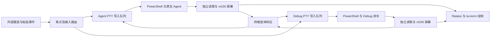

> 历史文档：本文件记录 v0.1 前台 MVP；v0.2 的当前行为和验收见 [03](03-Workspace-Implementation.md)、[04](04-Upgrade-Verification.md)。

# DevTabs Embedded Terminal MVP

日期：2026-11-09。项目名称：DevTabs。状态：前台 MVP 已实现，已完成自动化 ConPTY 和本机 Agent 启动检查；兼容性验收仍有未测项，见 [02-MVP-Verification.md](02-MVP-Verification.md)。

本阶段交付一个 Windows Rust TUI：在同一个界面中，左侧运行真实 Codex CLI 或 Claude Code，右侧运行独立的 PowerShell Debug 终端。用户能够在两侧正常输入、运行命令、查看输出，并调整宿主窗口大小。

这里的 MVP 是第一轮可运行的技术验证，用于决定内嵌终端路线是否满足真实使用需要。本文落实用户“先验证内嵌 Agent／Debug 双终端”的方向，采用前一轮推荐的库组合作为验证起点。它不表示整个产品规格已冻结，也不将此前确认的后台存活、共享日志小窗和三种布局要求从产品范围删除。

需要回答的核心问题是：**两个原生交互程序能否在本机 Windows Terminal、PowerShell 和个人 Profile 环境下，稳定地运行在我们绘制的两个终端区域中。** 能显示日志只是第一步；输入、终端协议和交互体验同样属于验收范围。

本阶段范围如下：

| 项目 | 本次实现 |
| --- | --- |
| 操作系统 | Windows；在用户现有 Windows Terminal 中运行 |
| 项目数量 | 启动时指定一个项目目录 |
| 会话数量 | Agent、Debug 各一个，分别创建 ConPTY 和 PowerShell 进程 |
| Agent | Codex CLI、Claude Code 分别验收；单次选择其中一个 |
| Agent 启动 | 新会话，或调用 Agent 自身的原生 resume 选择器 |
| Debug | 默认打开 shell，可指定启动命令，也可进入后手动运行 |
| 界面 | 左右分屏、焦点标识、角色及项目标题、简洁状态栏 |
| 核心交互 | 键盘输入、焦点切换、粘贴、鼠标、选择复制、滚动、窗口缩放 |
| 输出与故障 | 两侧独立读取、有限历史；一侧结束不结束另一侧 |
| 运行状态 | 区分 shell 进程生命周期与实际 Agent／Debug 命令状态，见下文 |

本阶段暂不实现项目发现与总览、收藏和最近使用、完整设置界面、安装及 PATH 修改、后台协调进程、关闭标签页后的存活与重连、独立 Debug 小窗、运行中三种布局迁移。它们是后续阶段，不能以本次 MVP 通过为由宣称已经实现。

建议初始布局如下。70:30 是技术原型的起始比例，可以在实现中调整，不作为最终视觉约定。

```text
┌─ ProjectName · Agent [焦点] ─────────┬─ ProjectName · Debug ───────┐
│                                    │                            │
│ 真实 Codex CLI / Claude Code         │ 独立 PowerShell            │
│ 原生菜单、输入框和对话输出             │ cargo run / cargo tauri dev │
│                                    │ 构建日志及命令输入           │
└────────────────────────────────────┴────────────────────────────┘
  焦点 Agent · shell 状态 · 管理快捷键提示
```

界面尺寸始终以终端字符行列计算。PTY 尺寸使用扣除边框和状态栏后的内容区域。窗口过小时显示尺寸提示，继续读取两侧输出，保留会话和屏幕状态；不向 PTY 发送零行或零列，不为适配尺寸而重建进程。

技术依赖采用以下组合。版本已按本轮 crates.io 最新稳定版核对并完成编译，以 Cargo.lock 中的解析结果作为复现依据。

| 依赖 | 使用版本 | 职责 |
| --- | --- | --- |
| `ratatui` | `0.30.2` | 布局、边框、状态栏、差量绘制 |
| `crossterm` | `0.29.0` | raw mode、终端设置与 Ratatui 后端 |
| `portable-pty` | `0.9.0` | Windows ConPTY、进程启动、读写及尺寸调整 |
| `tui-term` | `0.3.4` | 使用 `PseudoTerminal` 绘制子终端屏幕 |
| `vt100` | `0.18.1` | 终端输出解析、有限历史与查询回调 |
| `windows-sys` | `0.61.2` | 原生控制台输入、会话 Job Object 与进程树清理 |

Ratatui 和本工程统一使用 Crossterm 0.29.0。tui-term 0.3.4 默认仍依赖旧 vt100，因此禁用其默认 feature，由 `terminal.rs` 实现 `Screen` / `Cell` 薄适配层，使用新版解析器的查询回调；依赖树只有一个 vt100。PTY 与会话生命周期由本工程持有，不依赖 `unstable` controller。采用标准线程和有界通道，不引入异步运行时。辅助依赖包括 Clap 4.6.7、anyhow 1.0.104、arboard 3.7.0、base64 0.23.1、dunce 1.0.5。

Crossterm 的 Windows 事件读取忽略 `wRepeatCount`，也不生成 `Event::Paste`。`events.rs` 使用 `ReadConsoleInputW` 保留原始扫描码、控制键状态和重复次数，合并 UTF-16 代理对，并将 Windows Terminal 的 bracketed paste 组装成单个粘贴事件。Win32 input mode 按原始字段转发；传统模式按子终端状态编码。该实现有自动化用例，长按和真实 IME 仍需人工验收。

`alacritty_terminal` 保留为后续评估候选。当实测表明 vt100 的协议支持无法满足两个 Agent 时，再定位缺失能力并评估接入成本。它需要新的显示和输入适配，不能视为对 vt100 的直接替换。

程序内部按下面的流向组织：



查询响应必须按来源返回对应会话，不能跟随当前焦点。上图中的路由应保留 SessionId，不允许将 Debug 的查询响应写进 Agent。输入、粘贴和协议响应在每个会话内串行写入，防止字节交错。

建议保持一个 Cargo package，按职责拆成下列文件；这是内部组织建议，不提前冻结公开 API：

```text
Cargo.toml
Cargo.lock
src/
  main.rs          参数、自检、启动与退出
  events.rs        Windows 原始按键、重复次数、UTF-16 与粘贴事件
  app.rs           两个会话、焦点、管理模式、运行循环
  session.rs       PTY 所有权、独立读写、子进程等待与清理
  platform.rs      会话 Job Object 与先入 Job 再启动 shell 的内部宿主
  terminal.rs      解析器、屏幕、协议模式及查询响应
  input.rs         按键编码、粘贴、鼠标坐标与事件路由
  selection.rs     选择、复制与历史浏览
  launch.rs        工作目录、Agent argv、Debug shell 命令
  ui.rs            分屏、边框、光标、状态与错误展示
tests/
  pty_windows.rs   实际 PowerShell / DevTabs ConPTY、输出与退出验证
```

会话模型包含进程内唯一 SessionId、PTY 句柄、输入队列、独立解析器、历史容量、尺寸、宿主 PID、生命周期和 I/O 错误；角色与项目参数由 App 持有。`host_pid` 是等待 PowerShell 退出的内部宿主 PID，不冒充 shell 或 Agent PID。宿主转交 shell 退出码；实际 shell PID 通过集成 fixture 独立核验。第一轮使用 0/1 标识，不使用秒级时间戳作为会话身份。改变焦点、浏览历史和调整布局不重建进程。

实现按以下顺序推进。每一步形成可检查的结果，再进入下一步：

1. **建立可复现工程与双 shell。** 创建 Windows Rust binary，锁定依赖。验证项目目录和 PowerShell 可启动；先让两个 PTY 都运行 shell，均以项目路径作为工作目录。保留当前环境和 Profile，不默认添加 `-NoProfile`，不修改用户 Profile、PATH 或 Terminal 设置。确认两个 shell PID 不同，任一侧输入不会进入另一侧。
2. **补齐终端显示与协议通路。** 分别读取原始字节并增量送入解析器，处理颜色、光标、清屏、alternate screen 和历史。完成终端查询的识别与响应，避免 Agent 等待游标位置或终端能力时卡住。同步处理 PTY 与解析器的 resize，验收可控测试程序后再运行 Agent。
3. **完成输入和焦点。** 实现普通字符、控制组合键、功能键、粘贴和鼠标路由。焦点始终可见；只有管理模式接收管理命令，普通输入交给当前会话。先完成回显与字节断言，再检查原生 Agent 操作。
4. **运行两个 Agent。** 在同一个项目分别验证 Codex 和 Claude Code 的新会话、原生 resume、菜单及确认提示。两者逐个运行测试，不要求本轮在一个工作区同时运行两个 Agent。Debug 同时运行真实构建命令，验证输入与输出互不阻塞。
5. **完成复制、历史与退出。** 加入有界历史、区域选择复制、输出压力处理和正常退出流程。验收失败及异常路径，保留复现步骤、版本与结果，形成是否继续采用该组合的结论。

已实现以下启动入口，可执行程序位于 `target/release/devtabs.exe`；完整操作说明见 [README](../README.md)：

```powershell
# 默认 Debug 进入 shell，Agent 新会话
cargo run -- --project 'D:\Projects\Demo' --agent codex

# Debug 自动执行指定的 PowerShell 命令
cargo run -- --project 'D:\Projects\Demo' --agent claude --debug-command 'cargo run'

# 调用 Agent 自身的历史选择器
cargo run -- --project 'D:\Projects\Demo' --agent codex --resume
cargo run -- --project 'D:\Projects\Demo' --agent claude --resume
```

`--project` 必须解析成存在的目录，并支持中文、空格和 PowerShell 特殊字符。缺少参数、无效目录或缺少 Agent 时，在启动前明确报错，不静默换用另一个 Agent。`--resume` 使用之前已核对的 `codex resume` 或 `claude --resume`；不自动变成 `--last`，不因任意非零退出而自动新开对话。

启动模型区分“原生可执行程序＋参数数组”和“用户提供的 PowerShell 命令文本”。Agent 使用明确的 argv；Debug 命令保留完整 shell 语义，允许引号、管道及分号，不做按空白拆分或静默过滤。需要包装脚本时使用独立脚本文件和可靠的数据传递方式，避免把项目路径、Agent 参数与 Debug 命令拼成多层 `-Command` 字符串。PowerShell 以 `-NoExit` 保留命令结束后的 shell，项目 Profile 的可用性要进入真实验收。

本轮状态栏只声明可准确观察的 shell／PTY 进程状态：`starting`、`running`、`exited` 及退出码、或 `failed` 及错误。shell 启动成功不等于 Agent 已就绪；shell 退出码也不等于此前某条 Debug 命令的退出码。Agent 或 Debug 命令结束后，shell 留在提示符，用户可手动重跑。任意用户输入命令的自动生命周期跟踪留到后续 shell 集成阶段；不能通过“看到提示符”“一段时间没有输出”或历史文件更新时间推断命令状态及 Agent 思考状态。

键盘和协议处理需遵循以下规则：

| 场景 | 行为 |
| --- | --- |
| 普通字符、中文、Enter、Tab、Esc、方向键 | 发给焦点会话；Unicode 按 UTF-8 编码，保留实际输入语义 |
| Ctrl+C、Ctrl+D、Ctrl+Z 等 | 默认转发给子终端；不作为全局退出键 |
| 应用光标模式 | 根据子终端当前模式编码方向键，不能始终发送固定序列 |
| 按键 Press／Repeat／Release | 处理按下与重复，避免将释放事件再当成一次输入；实测长按行为 |
| 管理入口 | 原型暂定 Ctrl+G 前缀；随后 A/D 聚焦、S 切换选择模式、Y 复制、Q 发起退出、Esc 取消。Ctrl+G 连按两次向子终端发送一次 Ctrl+G |
| 管理键冲突 | 在 Agent 和 PSReadLine 中检查冲突；影响原生操作时调整前缀，不据此修改 Agent 的原生绑定 |
| 多行粘贴 | 处理完整 Paste 内容；依据子终端是否启用 bracketed paste 决定是否包裹；不逐行模拟 Enter |
| 终端能力与查询 | 明确哪些模式由宿主实现；对已支持的查询按实际状态回复，记录尚未支持的能力；不盲目宣告高级键盘协议 |

终端解析器提供屏幕状态，并不自动承担全部查询回复、键盘协议和剪贴板转发。必须审阅实际锁定版本的回调与能力；缺失时由 `terminal.rs` 集中适配，避免在输出字符串上零散替换控制序列。PTY 输出始终经过解析和区域绘制，不直接写入父终端 stdout，以免破坏另一个 pane 和管理界面。

鼠标、历史和剪贴板按以下方式验证：

- 内容区域的点击更新焦点；向子程序转发的鼠标坐标要减去 pane 的边框与偏移，并遵循该子程序请求的鼠标协议。点击边框和状态栏不发给子程序。
- 子程序请求鼠标事件时，正常模式转发；显式选择模式由宿主管理拖选和历史浏览，退出选择模式后恢复转发。不要依赖 Windows Terminal 对整个外层界面的选择来冒充 pane 内选择。
- 复制从所属 pane 的屏幕／历史数据提取文本，写入 Windows 文本剪贴板，保留中文和换行，排除边框及另一侧内容。只显示历史视口时继续读取新输出，提供回到实时输出的方式。
- 图片粘贴作为独立验收项：确认两个 Agent 当前版本的原生图片粘贴操作，在焦点 pane 中真实产生附件；文字路径回显不算图片粘贴通过。先查明外层事件、子程序快捷键和 Windows 剪贴板之间的实际路径，再补适配，不默认发送图片字节到 PTY。
- 验证从资源管理器拖入文件路径；路径包含中文、空格时不串入另一侧。若宿主把拖入路径转换成文本或粘贴事件，按实际行为记录。

并发组织应保证输出压力不会卡住输入。两个 PTY 各有独立读取线程，并在各自有界屏幕／历史模型中增量解析；界面只合并重绘通知。读写和锁等待不占用 UI 线程，绘制期间不长时间持有解析锁。输入队列有界，超载时保留整个粘贴操作的顺序并显示忙碌状态；原始输出不能为追赶帧率而直接丢弃。

初始历史建议每个会话保留 5,000 行，作为可调整的实验值，同时记录实际内存。重复日志只更新当前屏幕和有限历史；屏幕快照与重绘通知不建立无界队列。观察连续日志时的响应与内存变化，不能仅凭行数限制宣称内存目标已满足。

关闭流程必须清楚区分技术验证与完整产品要求：本 MVP 使用前台进程持有 PTY，**不提供 detach**。正常退出先显示“结束本次验证会话”的确认，再请求两个 shell／命令正常结束；超时保留界面并询问是否强制结束本次创建的进程。取消后继续原会话。

由于本轮不提供任意命令的 shell 就绪检测，正常结束优先让用户返回对应 pane，使用原生退出操作结束程序，再执行 shell 的 `exit`；由等待线程确认两个 shell 退出后收尾。可向仍运行的会话发送中断请求，但不把“已发送 Ctrl+C”视为已经停止，也不在未知前台程序仍占用输入时自动灌入 `exit`。确认界面和等待过程继续消费输出。

强制清理必须覆盖本次启动的进程树，并核对 portable-pty 在 Windows 上的实际行为；必要时使用 Windows Job Object 封装所有权。不能把 `ChildKiller::kill()` 当成“优雅退出且已清理所有子进程”的证明，不按进程名批量结束其他 PowerShell 或 Agent。异常、关闭宿主标签页及 panic 时的资源释放也要用测试子孙进程验证；无法可靠清理就记录为阻塞问题。恢复外层 raw mode、光标、鼠标捕获和粘贴模式，错误信息在终端恢复后输出。

界面和验证说明要明确“本次为前台验证，关闭不会提供后台重连”，避免用户按完整产品的 detach 语义操作。后续阶段再将 PTY 所有权迁移到独立会话宿主；本轮的 `session` 与 `ui` 边界为该迁移提供基础，不先实现完整 daemon/IPC 系统。

验收应先记录 Windows、Windows Terminal、PowerShell、Rust、Codex CLI、Claude Code 的实际版本及 Cargo.lock。先在原生 Windows Terminal 直接运行同一 Agent，作为对照，再执行内嵌用例。每个 Agent 单独填写结果：通过、失败、未测；附版本、步骤、现象和证据，不用一个 Agent 的结果替代另一个。

| 编号 | 验收操作 | 通过标准 |
| --- | --- | --- |
| V01 | 启动两个 shell，在两侧分别查询 PID、工作目录并输入不同标记 | PID 不同，工作目录正确，输入与输出无串线 |
| V02 | 依次运行 Codex、Claude 的新会话和原生 resume | 菜单、确认提示、历史选择器可操作；无启动卡死 |
| V03 | 中文 IME、中文路径、宽字符、常见 Emoji 输入与编辑 | 输入内容完整，光标和换行可用，无重复或丢字 |
| V04 | 粘贴含换行、制表符及特殊字符的文本 | 内容顺序完整，行为与原生 Agent 对照一致，不误触多次提交 |
| V05 | Agent 原生快捷键、补全、菜单、Ctrl+C、长按方向键 | 无宿主抢键或重复事件；管理前缀可转义 |
| V06 | 原生图片粘贴及拖入文件路径 | 两个 Agent 分别收到图片附件／正确路径，只进入焦点侧 |
| V07 | 两侧鼠标操作、选择复制、历史浏览及回到实时输出 | 坐标正确、文本不混入另一侧、历史期间后台输出继续读取 |
| V08 | 连续调整宿主大小，缩小到提示状态再恢复 | PTY/解析器尺寸一致，无零尺寸，shell PID 与 Agent 会话持续 |
| V09 | 使用 fixture 验证游标位置查询、模式切换、清屏及 alternate screen | 回复返回来源 PTY，光标正确，退出全屏程序后能恢复 |
| V10 | Debug 持续输出 60 秒、至少 10,000 行；同时在 Agent 操作菜单和编辑文本 | 不发生持续输入冻结、输出串线或无界内存增长，记录实际延迟和内存 |
| V11 | Debug 执行 `cargo run`、`cargo tauri dev`，关闭调试软件 | 记录命令/Watcher 是否结束；shell 和日志仍可用；不预设二者行为一致 |
| V12 | 使一侧命令报错、正常退出或使一侧 shell 退出 | 另一侧仍可输入；已退出侧保留最后画面，shell 状态准确 |
| V13 | 正常退出、取消退出、超时强制结束和关闭宿主 | 验证进程树清理与外层终端恢复；不影响工具外的进程 |
| V14 | 以中文/空格路径启动，分别保留个人 Profile 和做隔离对照 | 默认环境可用；若失败能区分 Profile、PTY、编码和宿主因素 |

自动化检查聚焦会丢失交互语义的部分：输入编码和焦点路由、粘贴不交错、鼠标坐标变换、resize 非零尺寸、终端查询响应、退出状态与单侧失败隔离。用可控子程序回显实际收到的字节、模拟长输出和产生子孙进程，避免仅断言模型字段。Ratatui TestBackend 可检查边框、焦点及错误展示，不能替代真实 Windows/Agent 验收。

后续实现阶段的基础检查建议为：

```powershell
cargo fmt --check
cargo clippy --locked --all-targets -- -D warnings
cargo test --locked
cargo build --release --locked
```

依赖无法按锁文件构建时先定位原因，不修改锁文件后仍宣称原快照可复现。单元测试通过、HTML 原型可操作、普通 shell 能显示，都不足以判定内嵌 Agent 兼容性通过。

本轮完成应交付 Windows 可运行程序、源码和锁文件、启动说明、逐 Agent 验收结果、失败项的最小复现，以及结论。结论采用三种明确状态：核心用例全部通过，可继续建设；明确失败，需要补适配或评估其他终端核心；关键项未测，继续验证。图片、输入、鼠标或原生 Agent 操作失败时，不能只因双 pane 已显示就标为完成。

完整产品的 100 项目/8 会话、预热可操作≤200ms、搜索≤50ms、自有进程空闲 CPU≤1%及内存目标≤100MB，仍按原访谈记录保留。当前双会话只记录基线，不代替完整规模测试。本轮通过后，下一项是独立会话宿主的关闭/重连验证，再验证共享 Debug 小窗及三种布局迁移，随后接入项目总览和配置。

本文件依据下列本地记录及文档；外部资料核对日期为 2026-11-09：

- [第四轮原始回答](../interviews/project-launcher/history/answers-r004.json)：已确认的完整产品需求，不把当前技术验证范围当成需求删减。
- [内嵌终端可行性记录](../interviews/project-launcher/research/embedded-terminal-feasibility.md)：ConPTY 路线、原生 resume 及未验证项。
- [DevTabs 深度调研](../interviews/project-launcher/research/devtabs-deep-review.md)：避免直接沿用标签页索引、秒级身份和 shell 上报即 Agent 就绪的判断；其先前实验排序已由本轮“先内嵌双终端”方向调整。
- [portable-pty](https://docs.rs/portable-pty/0.9.0/portable_pty/)：PTY 与子进程接口；Windows 强制结束行为仍需按实现核验。
- [tui-term 0.3.4 依赖清单](https://docs.rs/crate/tui-term/0.3.4/source/Cargo.toml)：Ratatui、Crossterm、vt100、portable-pty 的版本关系及 unstable feature。
- [tui-term nested_shell 示例](https://docs.rs/crate/tui-term/0.3.4/source/examples/nested_shell.rs)：基础数据通路参考。示例含未完成的按键/粘贴处理、未处理的鼠标事件，resize 路径只展示了解析器调整，不能原样当成完整双终端实现。
- [vt100 屏幕接口](https://docs.rs/vt100/0.18.1/vt100/struct.Screen.html)：模式、历史和光标能力；[回调接口](https://docs.rs/vt100/0.18.1/vt100/trait.Callbacks.html)用于查询回复及额外模式跟踪。
- [Microsoft 创建伪控制台会话](https://learn.microsoft.com/en-us/windows/console/creating-a-pseudoconsole-session)：宿主读写及生命周期责任。
