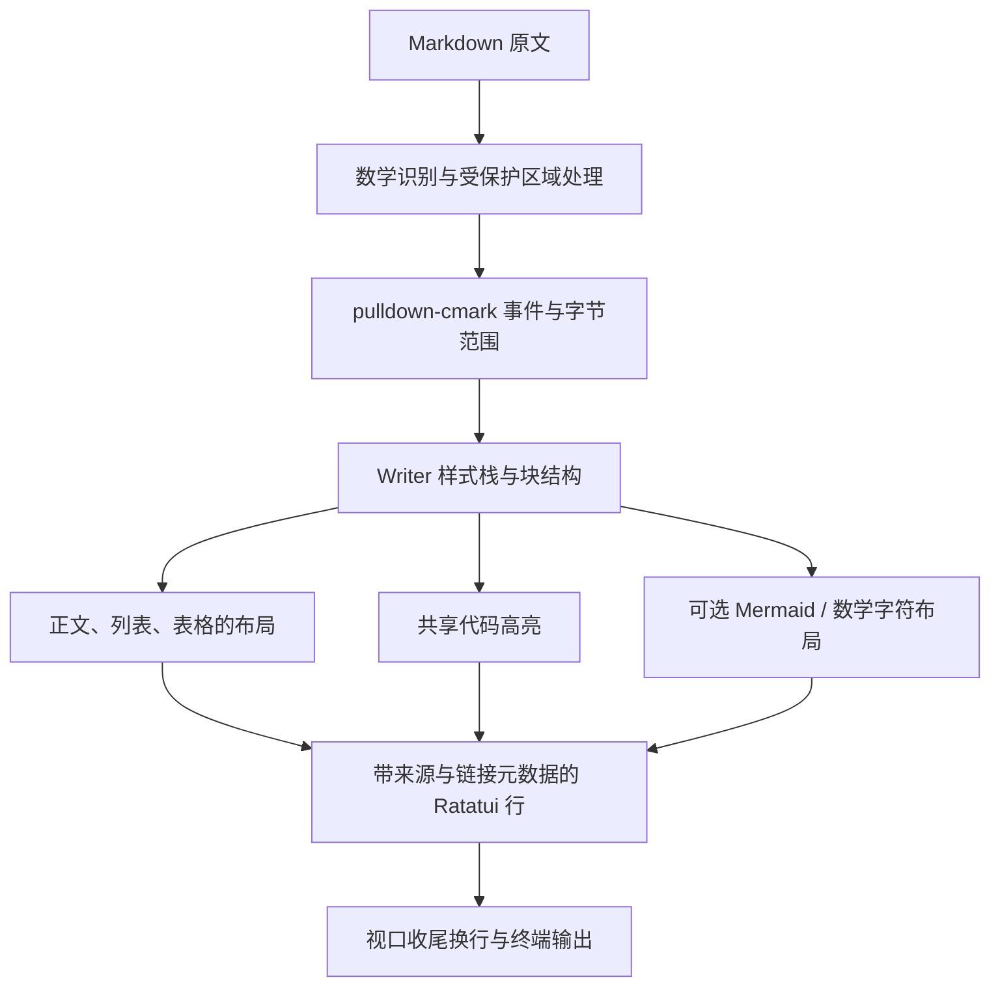

# Codex Markdown Rendering Research

日期：2026-11-10。研究对象：本地 `refer/codex-main`；对照对象：DevTabs 0.3.2。

本文记录源码研究、独立运行验证及针对本项目的建议。本次没有修改 DevTabs 产品代码，也没有编译完整 Codex。源码快照的 workspace 版本为 `0.0.0`，不能据此确认发布版本，也不能认定用户截图运行的就是这份快照；关键文件哈希见 [research.json](../artifacts/codex-markdown-research/research.json)。

## 1. 结论

**DevTabs 现有的 Rust + Ratatui 技术路线可以实现相近的 Markdown 阅读体验。** Codex 的关键是直接把 Markdown 语义转换为带主题、缩进、换行和来源信息的终端行，再按视口布局。效果来自这些细节共同作用。

最值得优先借鉴的五点：

1. Markdown 正文与代码共用语法主题；标题、强调、引用、链接各有明确层次。
2. 正文、代码、列表、表格分别采用适合自己的排版策略。
3. 按终端显示列计算宽度，换行时保留样式、缩进和来源信息。
4. 宽表在窄窗口中可以转换成逐条键值记录。
5. 在昂贵的高亮和图形转换之前检查输入预算，失败时保留可读源码。

源码还提供了 **Mermaid 子集和 TeX 数学子集的 Unicode 排版**，独立探针已经验证可运行。因此，之前“终端只能显示 Mermaid、公式源码”的说法过于绝对。准确边界是：终端可渲染有限的字符布局；完整 Mermaid、完整 LaTeX 和浏览器排版超出这些模块的能力。

## 2. 从源码到终端的调用链



主要阅读入口：

| 职责 | 源码位置 | 核心事实 |
| --- | --- | --- |
| Markdown 视口入口 | [markdown.rs:41](../refer/codex-main/codex-rs/tui/src/markdown.rs:41) | 渲染后仍检查超宽物理行，并重映射来源与链接 |
| Agent 消息入口 | [markdown.rs:127](../refer/codex-main/codex-rs/tui/src/markdown.rs:127) | 包含聊天专用的内容重写与链接处理 |
| 解析与 Writer | [markdown_render.rs:457](../refer/codex-main/codex-rs/tui/src/markdown_render.rs:457) | 直接消费 pulldown-cmark 的带 offset 事件 |
| Markdown 主题 | [markdown_render.rs:138](../refer/codex-main/codex-rs/tui/src/markdown_render.rs:138) | 从 Syntect 主题的 markup scopes 提取正文样式 |
| 代码高亮 | [highlight.rs:676](../refer/codex-main/codex-rs/tui/src/render/highlight.rs:676) | 整个代码块共享连续词法状态；超预算提前退出 |
| Unicode 换行 | [wrapping.rs](../refer/codex-main/codex-rs/tui/src/wrapping.rs) | 保留 Span、字素、链接及悬挂缩进 |
| 逻辑行来源 | [source.rs:24](../refer/codex-main/codex-rs/tui/src/terminal_hyperlinks/source.rs:24) | 保存原文、范围、样式、显示前缀与复制元数据 |
| 单宽度缓存 | [markdown_render_cache.rs:14](../refer/codex-main/codex-rs/tui/src/history_cell/markdown_render_cache.rs:14) | 宽度、主题版本、终端颜色等共同决定缓存有效性 |

Codex 使用自己的渲染器，没有使用 `tui-markdown`。其中“自己实现”的部分主要是展示层；Markdown 解析仍复用成熟解析器。DevTabs 若沿此方向调整，也无需另写 Markdown 语法解析器。

## 3. 为什么正文看起来更清楚

### 3.1 主题来自同一套语义颜色

[MarkdownStyles::for_theme](../refer/codex-main/codex-rs/tui/src/markdown_render.rs:138) 从主题提取标题、粗体、斜体、列表、链接和引用颜色：

| 元素 | 样式处理 |
| --- | --- |
| H1 | 主题标题色、粗体、下划线 |
| H2 | 主题标题色、粗体 |
| H3 | 主题标题色、粗体、斜体 |
| H4–H6 | 主题标题色、斜体 |
| 强调 / 加粗 | 分别采用 markup.italic / markup.bold 的颜色与修饰 |
| 行内代码 | raw markup scope 的颜色；缺失时用强调色 |
| 链接 | 主题链接色与下划线 |
| 引用 | 主题 quote scope；有缺省颜色 |

默认深色语法主题为 **Catppuccin Mocha**，浅色为 **Catppuccin Latte**，也支持覆盖，见 [highlight.rs:209](../refer/codex-main/codex-rs/tui/src/render/highlight.rs:209)。不能仅凭截图确认用户实际采用的主题。

部分正文前景色还经过终端背景和颜色能力相关的可读性调整；[contrast.rs:18](../refer/codex-main/codex-rs/tui/src/style/contrast.rs:18) 的文本对比度目标为 4.5。未知背景和颜色能力有回退分支，不能理解为每种终端的所有颜色均保证达到该数值。

**标题仍保留 `#`。** [start_heading:852](../refer/codex-main/codex-rs/tui/src/markdown_render.rs:852) 明确生成与级别对应的 `#` 前缀。DevTabs 0.3.2 隐藏标题标记是一项显示选择，不能把隐藏标记当作改善层次的主要手段。

### 3.2 样式必须贯穿整条管线

Writer 通过样式栈叠加嵌套样式。转换为 owned 行时，[line_to_static:21](../refer/codex-main/codex-rs/tui/src/render/line_utils.rs:21) 同时保留 `Line.style`、`Line.alignment` 和各个 `Span.style`。

这与 DevTabs 上次修复的问题直接对应：只复制 Span 内容和样式，会丢失父级样式。主题再好，如果换行、缓存或搜索叠加时丢失样式，最终界面仍会退化成接近纯文本的效果。

### 3.3 留白、列表和引用有结构

段落间距、代码块前后留白和列表缩进由块结构决定。任务列表使用 `☑` / `☐`，有序任务项保留编号，换行后对齐正文；复制元数据另存 `[x]` / `[ ]`，见 [task_lists.rs:8](../refer/codex-main/codex-rs/tui/src/markdown_render/task_lists.rs:8)。

列表有 AfterMultiline、Compact、Uniform 等间距策略，适应原生滚动输出、流式消息和完成后的独立视图。DevTabs 文件预览只需固定一种一致的阅读策略，不必立即暴露多种设置。

## 4. 代码高亮与换行

### 4.1 代码复用共享高亮器

Codex 同样采用 **Syntect + two-face**，扩展语法集全局初始化。语言查找还补充 `golang → go`、`python3 → python`、`shell → bash` 等别名。

[start_codeblock:1162](../refer/codex-main/codex-rs/tui/src/markdown_render.rs:1162) 从围栏信息的第一个逗号、空格或 Tab 前提取语言。因此 `rust,no_run` 和 `rust title=demo` 都能找到 Rust 语法。DevTabs 当前按空白拆分，值得补上逗号元数据的测试。

[convert_style:581](../refer/codex-main/codex-rs/tui/src/render/highlight.rs:581) 保留语法前景色与粗体，跳过语法主题背景、斜体和下划线，以避免覆盖终端背景或产生过密装饰。这不影响 Markdown 正文自身的斜体、链接下划线。

DevTabs 已解决 Rust / JSON / TOML / PowerShell 的语法覆盖问题。下一步应统一主题与代码块布局，而不是继续通过堆叠语法库改善观感。

### 4.2 正文与代码采用不同策略

[flush_current_line:2395](../refer/codex-main/codex-rs/tui/src/markdown_render.rs:2395) 对正文做按词换行并处理续行缩进，对代码块保留空白、不在该层进行正文式重排。不过，视口入口仍会拆分超宽物理行；不能概括为“Codex 所有代码永远不换行”。

DevTabs 目前在 [preview.rs:430](../src/preview.rs:430) 对 Markdown 渲染结果统一预换行。改造时应保留块类别：正文按词换行，表格内部布局一次，代码明确选择保留长行并横向滚动或按显示列折行。现有源码预览已有的横向阅读能力可优先复用。

[width.rs:19](../refer/codex-main/codex-rs/tui/src/width.rs:19) 和 `wrapping.rs` 按显示列、字素簇处理宽度，而不是字节数或字符数量。中文、组合字符、emoji、半角浊音符以及极窄视口都有专项处理。URL 在能容纳时尽量保持完整，超宽时再拆分。

## 5. 表格是布局问题

[表格布局管线](../refer/codex-main/codex-rs/tui/src/markdown_render.rs:1469) 先统计列内容，再决定宽度和呈现方式：

1. 区分长路径/URL 等 TokenHeavy 列、说明性 Narrative 列、短值 Compact 列。
2. 为列计算最小值和偏好宽度；列最小内容宽度为 3 个显示列。
3. 宽度不足时按上述类别顺序收缩，优先保留短状态、编号等字段的完整性。
4. 使用批量均衡与二分查找收缩宽度，避免逐列宽度单位地循环扣减。
5. 无法正常排布，或单元格普遍被切得过碎时，转换成键值记录。

降级入口见 [markdown_render.rs:1536](../refer/codex-main/codex-rs/tui/src/markdown_render.rs:1536) 与 [table_key_value.rs](../refer/codex-main/codex-rs/tui/src/markdown_render/table_key_value.rs)。表头加粗，分隔线采用较弱颜色，避免边框压过正文。

例如窄侧栏中的三列表格可以读成以下结构，而不是强行挤成三条字符列：

```text
文件: Cargo.toml
作用: 项目依赖与构建配置
状态: 已修改
```

对 DevTabs 的侧栏预览，这比原样移植聊天消息的全部功能更有直接价值。

## 6. Mermaid 与数学的真实边界

### 6.1 Mermaid：可以独立复用的叶子模块

[codex-mermaid](../refer/codex-main/codex-rs/mermaid/README.md) 是纯 Rust 字符布局模块，正常依赖只有 `unicode-width`，不做 I/O。公开接口为 [render / render_spans](../refer/codex-main/codex-rs/mermaid/src/lib.rs:49)，后者提供 Node、Edge、Text 语义角色，颜色由调用方决定，没有内嵌 ANSI 转义。

它支持流程图、时序图、平面状态图、类图、ER 图的明确子集。主要上限包括 16 KiB 输入、图结构 16 个节点 / 24 条边、标签每行 40 显示列、65,536 画布单元；时序图另有 8 参与者、64 事件、4 层片段上限。

子图、复合状态、完整样式指令等许多 Mermaid 语法不支持。出现 Unsupported、Limit、TooWide 时，不返回残缺图；由上层保留源码。Codex 的适配层还检查围栏确实闭合，再转换为图形。

若 DevTabs 增加此能力，建议提取为带来源说明的最小内部 crate；生产构建应有自己的稳定源码目录，不能依赖 `refer/`。沿用其边界与测试比重新写 Mermaid 解析和路由划算。

### 6.2 数学：字符排版与原文识别必须一起考虑

[math.rs](../refer/codex-main/codex-rs/tui/src/markdown_render/math.rs) 在 Markdown 转义处理前识别 `$…$`、`$$…$$`、`\(…\)`、`\[…\]`，保护代码、链接与 HTML 区域，并保留源范围。转换预算为单式小于 4,096 字节。

[math/render.rs](../refer/codex-main/codex-rs/tui/src/markdown_render/math/render.rs) 实现有限 TeX 子集，支持分数、上下标、希腊字母、部分算符和矩阵等；布局最多 16 行、256 列。空间布局必须完整容纳，嵌套块还有更保守的限制。未知命令、超预算或无法容纳时，上层恢复原文。

独立运行得到的部分输出：

```text
E=mc²

1
─
2

⎛ a  b ⎞
⎝ c  d ⎠
```

这些是字符布局，不是完整 LaTeX 引擎。移植时不能只抽取公式字符串替换函数：美元金额误判、代码保护、来源映射、窄窗回退和复制原文都需要一起验证。

## 7. 显示内容与原文应分别保存

[HyperlinkLine](../refer/codex-main/codex-rs/tui/src/terminal_hyperlinks.rs:178) 在 Ratatui 行之外保存链接和逻辑来源。来源中有原文 `Arc<str>`、范围、样式范围、续行缩进、合成前缀长度、复制信息等。

这一设计解决的是具体问题：换行和缩进增加的字符不应混入原文；任务框、表格、公式和图形的显示形式可能不同于源码；链接文字的位置也会随着排版改变。

DevTabs 当前 `Rendered` 保存渲染文本和显示行字符串，见 [preview.rs:278](../src/preview.rs:278)。如果增加更多视觉转换，建议从最小的块/行来源映射开始，保留原始 Markdown；不要试图从最终显示文本反推原文。搜索命中位置、鼠标选择、复制可据此逐步完善。无需先复制 Codex 的全部聊天复制协议。

## 8. 性能与缓存的取舍

### 8.1 先限制工作量，再检查输出

Codex 在进入 Syntect 之前检查：总代码不超过 512 KiB、不超过 10,000 行、任意单行不超过 4 KiB，见 [highlight.rs:652](../refer/codex-main/codex-rs/tui/src/render/highlight.rs:652)。超限直接走可读纯文本回退。

DevTabs 已有文件读取预算及输出 Span 上限，但 [preview.rs:426](../src/preview.rs:426) 的 Span 检查发生在渲染之后，不能单独限制极长行的高亮 CPU 成本。建议补充高亮前的总量和单行预算；数值应按本项目实测确定，而不是机械照搬。

### 8.2 只缓存当前需要的布局

Codex 完成后的 Markdown 缓存只保留最近一个宽度的结果。缓存键包含宽度、列表间距、主题版本、终端前景/背景和颜色等级。改变主题或窗口宽度时替换旧结果，不无限保留每个历史宽度。

DevTabs 可以沿用后台渲染与现有统计点，补齐缓存失效条件。需要测量首次加载、重复绘制、连续 resize、主题切换、极端表格和长行高亮的延迟与内存，之后再决定是否增加进一步缓存。本次没有测得新渲染器比现有实现更快。

### 8.3 文件预览不需要聊天流式系统

[streaming/render.rs](../refer/codex-main/codex-rs/tui/src/streaming/render.rs) 维护已稳定前缀和仍可变化的末块，遇到引用链接定义等影响前文的结构时会重算；代码流式高亮也保留词法状态。

文件预览通常按完整文件或编辑缓冲区渲染，保留后台任务和过期结果丢弃即可。完整复制流式消息状态机会增加与当前问题无关的复杂度。

## 9. 对 DevTabs 的建议方案

| 顺序 | 建议 | 理由 |
| --- | --- | --- |
| 1 | 统一 Markdown / 文件 / 编辑器语法主题，固定块间距与标题层次 | 最直接改善整体阅读体验 |
| 2 | 明确保留块类型，完善正文、代码和列表的换行 | 避免统一预换行破坏结构 |
| 3 | 增加表格宽度分配与窄窗键值记录回退 | 与侧栏空间约束直接相关 |
| 4 | 保留原文映射，补齐高亮前预算和缓存失效条件 | 为搜索、选择和后续转换建立正确基础；预算应随相关路径改造同步落地 |
| 5 | 按需引入 Mermaid 子集 | 已有边界清晰、可独立运行的模块 |
| 6 | 再引入数学子集与原文识别 | 需要额外验证歧义、嵌套与复制行为 |

**建议的实现方向：复用成熟解析器，借鉴 Codex 的展示层，替换现有围栏标记与二次扫描适配。**

当前 `tui-markdown` 足够承担基本预览；但若目标同时包含块级换行、响应式表格、图表、公式和来源映射，继续在其最终 `Text` 输出上修补会越来越困难。可以将 pulldown-cmark 作为直接依赖，由小型本地 renderer 消费事件，复用现有 Syntect / two-face、文件读取、后台线程、编辑器和性能统计。

模块先按职责分成主题、高亮、Markdown 布局即可；表格、Mermaid、数学在实际接入时再拆分。不需要先引入通用插件系统或渲染框架。

### 需要避免的照搬

- **整个 codex-tui 不能当作即插即用的 Markdown 库。** 主要入口为内部接口，依赖主题、终端能力、聊天来源及大型 workspace。超链接输出层还使用 Ratatui 的单元格宽度/差异 API，需要单独核对目标版本。
- Codex 快照声明 pulldown-cmark 0.10；DevTabs 当前间接锁定 0.13.6。移植事件处理需按实际版本适配，不能原样粘贴旧 Tag / Event 匹配，也无需为照搬代码降级解析器。
- Agent 入口会处理聊天特有的可视化链接，并可能展开包含表格的 Markdown 围栏。文件预览中的 fenced Markdown 示例必须保持字面内容，不能照搬这一预处理。
- DevTabs 中嵌入的 Agent PTY 已接收 Agent 自己排版的终端输出。不要再次把它当 Markdown 渲染；本项目应改善的是自己拥有的文件预览区域。
- 此渲染器也不是完整 GFM/浏览器：HTML 按文本处理，解析选项没有启用所有扩展，不能把引用中的 `[!NOTE]` 外观当作完整 GitHub Alerts 支持。
- 复用源码保留 Apache-2.0 的 LICENSE、NOTICE 和来源记录；仓库 NOTICE 同时列有 Ratatui 派生代码的 MIT 声明。独立探针已保留相应文件。

## 10. 实施前后的验证要求

产品改造前先固定 0.3.2 的文字、实际 Buffer 样式和性能基线；新增断言先确认能检出当前缺失，再升级渲染器。完成每一步后继续执行现有预览、编辑、保存冲突和嵌套 PTY 回归。

| 测试组 | 必须观察的结果 |
| --- | --- |
| 主题与样式 | 明暗主题；H1–H6、嵌套粗斜体、删除线、引用、链接；换行与搜索叠加后样式仍正确 |
| 视口布局 | 20 / 40 / 80 / 120 列及极窄边界；中文、emoji、组合字符、长 URL；列表续行正确缩进 |
| 代码 | Rust、JSON、TOML、PowerShell、未知语言；`rust,no_run`；Tab、空行、嵌套围栏和长行；保留词法状态 |
| 表格 | 中文、链接、长路径、多段说明、对齐；窄窗转换后仍能确认字段与记录对应关系 |
| 来源与交互 | resize 后选择、搜索定位、复制语义符合约定；字面 Markdown 围栏不被误转换；编辑缓冲区预览不修改原文 |
| 扩展与回退 | 图表未知语法、未闭合围栏、超宽/超限；公式未知命令、金额、代码内美元符号；失败时源码可读 |
| 资源 | 高亮前预算确实跳过昂贵工作；冷/热渲染、连续 resize、主题切换、工作集峰值；复用既有统计方法 |

Codex 的 [markdown_render_tests.rs](../refer/codex-main/codex-rs/tui/src/markdown_render_tests.rs) 同时包含样式断言与文本快照。DevTabs 也应直接断言 `fg`、`bg`、`Modifier` 和实际 Buffer，不能只验证标题文字存在。快照适合布局回归，但不能单独证明配色正确；还需要在用户实际终端检查字体修饰、列宽和颜色表现。

## 11. 本次独立验证

隔离探针位于 [mermaid-probe](../artifacts/codex-markdown-research/mermaid-probe/README.md)，单独构建到 `target/codex-research`：Mermaid 直接编译参考叶子模块；数学渲染器使用逐字节相同的两个源码副本，附一个显示宽度适配函数，没有修改 `refer/`。

```powershell
cargo run --offline --manifest-path artifacts/codex-markdown-research/mermaid-probe/Cargo.toml --target-dir target/codex-research
```

退出码 **0**，断言通过：流程图与时序图输出、输出无 ANSI、图形宽度约束、未知 Mermaid 语法、16 KiB 输入上限、分数/上标/矩阵排版、未知数学命令与宽度超限拒绝转换。编译有一个参考数学枚举变体未在探针中使用的 dead-code 警告。

证据见 [render-probe.log](../artifacts/codex-markdown-research/render-probe.log) 与 [research.json](../artifacts/codex-markdown-research/research.json)。此探针证明叶子排版模块可独立运行；没有覆盖 Markdown 数学识别、完整主题、交互、全部图形语法或 DevTabs 集成效果，也没有宣称运行了 Codex 全量测试。
