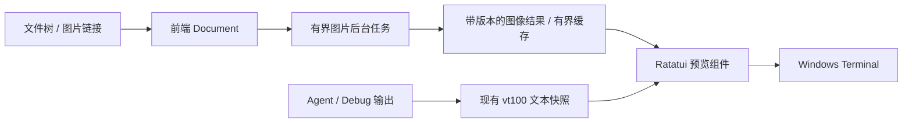

# Terminal Image Preview Design

日期：2026-11-10。项目：DevTabs。设计基线：`26d8370`。

状态：已落地图片预览与自动化验证；Windows Terminal 真机画质、清理及输入体验由用户验收。实现证据与边界见 [22-Terminal-Image-Preview-Verification.md](22-Terminal-Image-Preview-Verification.md)。本文承接 [预览操作与持久书签](20-Preview-Controls.md) 中暂缓的图片预览，保留设计目标；下方尚未勾选的真机验收及扩展对照不表示已经通过。真机 UI 由用户验收；开发期间完成自动化验证、基准统计及验收材料，不自动操作用户正在使用的 Windows Terminal。

## 1. 需求与设计结论

对话记录确认的需求是 Windows Terminal、Rust、照片与软件截图均需兼顾，并重视画质、响应速度和资源占用。本项目另有已经落地的文件树、预览标签、Markdown 阅读、编辑、Agent/Debug 分区及性能统计，因此不能直接照搬独立图片 CLI 的结构。

本项目采用以下路线：

1. Windows Terminal 下优先使用 Sixel，探测不确定或用户指定时使用 Half-block。
2. 复用 `ratatui-image` 的 Ratatui 绘制、像素与字符单元映射、可视裁剪和 Half-block，不自行实现完整图形协议或另一套图片组件。
3. 图片由 DevTabs 前端预览区绘制，读取、解码、缩放和编码在后台执行。
4. 先验证嵌入 DevTabs 后的重绘、弹窗和清理行为；随后完成独立图片标签，再完成 Markdown 本地行内图片。
5. 照片与截图采用可选择的画质配置；实际默认参数由同一素材集的对照结果决定。
6. 缩放库、新版编码器和额外缓存都必须有测量收益；没有收益则撤回对应复杂度。

项目处于开发期，可以重构内部状态和接口，不保留不必要的兼容层。破坏性改动必须同时验证图片新功能与已有文本、编辑、终端功能。

### 1.1 范围

| 纳入本设计 | 暂不纳入 |
| --- | --- |
| 本地 PNG、JPEG、静态 WebP、静态 SVG（后续扩展见 23） | GIF/APNG/动态 WebP 播放、视频 |
| 文件树打开图片、图片标签及缩放平移 | 图片编辑、保存图片、OCR |
| Markdown 本地图片及视口裁剪 | 自动下载远程图片、PDF 渲染 |
| 图片版本刷新、外部打开、信息面板 | 把图片作为位图复制到系统剪贴板 |
| Sixel 与 Half-block、协议诊断 | Kitty/iTerm2 产品适配、GPU 管线、内容分类模型 |
| 前端直接展示文件图片 | Agent/Debug 原生输出的图形协议透传 |

动画格式必须识别并说明暂不支持，不把静态解码器返回的首帧误报为完整支持。以后需要首帧预览时单独定义入口和标识。

## 2. 调研事实与原方案调整

以下事实来自 2026-11-10 的网页、发布说明、版本化文档与源码核查。实现时再次核对版本和 API，并固定 `Cargo.lock`。

| 已确认事实 | 对本项目的影响 |
| --- | --- |
| Windows Terminal Preview 1.22 引入 Sixel，稳定版 1.22 随后包含该能力 | 版本是运行条件线索，实际输出链路仍需探测；优先在当前稳定版上验收 |
| Kitty Graphics 支持议题仍开放 | 不把 Kitty 当作 Windows Terminal 已具备的能力 |
| `ratatui-image 11.1.0` 依赖 Ratatui `^0.30.1`，本项目使用 0.30.2 | 具备版本对接基础，仍需编译和输出回归验证 |
| 该组件默认 features 包含 Chafa 动态库支持 | 显式关闭默认 features，避免给 Windows 用户增加运行时安装要求 |
| 该组件依赖 `icy_sixel ^0.5.0`，Sixel 编码入口使用默认 `EncodeOptions` | 不能声称现成 Picker 可以配置所有照片/截图参数，也不能声称已接入 0.7 |
| `icy_sixel 0.5` 已有 Wu、K-means、最大颜色数和扩散强度 | 不能仅凭版本号认定 0.7 更快或画质更好 |
| `ratatui-image` 提供 `SlicedImage` / `SlicedProtocol` | Markdown 垂直可视裁剪优先复用；横向平移和精确像素边界需要单独验证 |
| `Picker::from_query_stdio` 会读取终端响应，要求在事件读取开始前调用 | 不能与 DevTabs 的 Windows 输入读取器并发抢 stdin |
| Windows Terminal 的图像擦除、输出顺序和 ConPTY 行为存在实际约束 | 编码成功、TestBackend 通过均不等于终端集成通过 |

参考文档最后推荐 `image + icy_sixel + 自实现 Half-block`，其独立 CLI 场景下的理由成立。本项目已经使用 Ratatui，改为优先复用 `ratatui-image`。保留原方案中先缩放再编码、避免重复量化、照片/截图对照、真实 Windows 基准等原则。

原讨论中出现的“256 色”指本设计采用的编码调色板上限，不推导为所有 Sixel 技巧的绝对上限。首期不采用多图层、多调色板叠加来模拟更多颜色；这会增加输出量及覆盖清理复杂度，且目标终端有相关异常报告。

## 3. 依赖与接入策略

| 组件 | 调研版本 | 决策 |
| --- | --- | --- |
| `ratatui-image` | 11.1.0 | 主图片组件；关闭默认 features，启用与现有后端对应的 `crossterm` |
| `image` | 0.25.10 | 显式启用 `png`、`jpeg`、`webp`；复用组件内部相同版本依赖 |
| `icy_sixel` | 组件依赖 0.5；最新稳定 0.7.0 | 先建立组件原生基线；0.7 作为编码对照候选 |
| `quantette` | 最新稳定 0.6.0 | 由实际选定的编码器使用，不额外重复量化；0.5 编码器与 0.7 编码器的传递依赖不同 |
| `fast_image_resize` | 6.1.0 | 只有缩放热点和画质对照证明收益后引入 |
| `criterion` | 实现基准时核对 | 仅用于开发基准，不为生产运行增加基准框架依赖 |

基线依赖配置意图如下；落地时以 Cargo 解析、feature tree 与编译结果为准：

```toml
ratatui-image = { version = "11.1.0", default-features = false, features = ["crossterm"] }
image = { version = "0.25.10", default-features = false, features = ["png", "jpeg", "webp"] }
```

不启用 `image-defaults`、Chafa 或额外异步运行时。使用现有标准线程模型。通过 `cargo tree -e features` 和 `cargo tree -d` 检查格式支持、重复依赖及额外系统库。

### 3.1 画质参数的适配门槛

原生组件默认配置只用于阶段 0 的集成基线。正式提供 Photo/Screenshot/Mixed 选择前，必须补上明确的编码参数入口，不允许界面显示已切换而实际仍采用默认参数。

先评估组件公开的协议数据构造入口能否满足独立图片标签；同时验证裁剪、旧区域清理和光标恢复。不能为了绕过默认参数而重复编码一次或破坏切片组件的约束。

如果正式功能需要的参数无法通过公开接口一致地接入，允许维护一个固定上游版本、范围明确的 `ratatui-image` 小补丁：传递编码参数，必要时接入经过对照验证的编码器版本。布局、协议绘制和切片仍沿用组件。源码及其许可证放入 `vendor/ratatui-image`，用 Cargo patch 显式接入，并记录上游版本、补丁内容及撤销条件。

不得直接把 `^0.5` 用版本替换声明伪装成已兼容的 0.7；API、Alpha、输出序列与切片解析均需要测试。基准可以分别编译两个版本进行比较，生产路径最终只保留一条编码路径。尚无收益时保留组件使用的 0.5，不为追新维护分叉。

## 4. 用户界面与交互

### 4.1 独立图片标签

单击支持的图片文件，在现有预览区创建或复用标签。文件树、Agent、Debug、Split/Float/Tabs 布局行为沿用现有规则；不另开图片浮窗。预览最大化仍用 `Z`。

保留完整四边框、三行标签、标签间距、当前标签标识、标题提示、右键菜单、8 标签上限及关闭保护。图片内容使用既有四周留白后的内容区域，滚动条不占用图像像素。

默认使用“适应窗口”，保持宽高比且不主动放大小图。图片居中，未占满区域显示预览背景。工具栏按宽度收起到 More；文件名不能被按钮覆盖。

| 操作 | 拟定入口 | 行为 |
| --- | --- | --- |
| 适应窗口 | `0`、工具栏、More | 恢复按可用像素尺寸适配，取消手动平移 |
| 100% | `1`、工具栏、More | 一个图像像素对应一个终端图形像素；超出内容区可平移 |
| 放大 / 缩小 | `+` / `=`、`-`、Ctrl+滚轮、More | 保持视口中心；鼠标缩放优先保持指针指向位置 |
| 平移 | 方向键、滚轮、Shift+滚轮、滚动条 | 限制在缩放后的图像边界内，无正文选择 |
| 大步平移 | PageUp/PageDown | 按当前可见高度平移，边界处停止 |
| 最大化 / 恢复 | `Z`、More | 与文本预览相同，图像重新适配或保持手动缩放中心 |
| 文件信息 | `I`、More | 路径、文件大小、格式、原始尺寸、Alpha、修改时间、缩放及协议 |
| 外部打开 | `O`、More | 用系统应用打开原文件 |
| 刷新 / 重试 | `F5`、More | 重新验证文件版本；失败不会无限自动重试 |
| 复制绝对路径 | `Alt+C`、标签右键、More | 沿用现有路径复制 |
| 切标签 / 关闭 | 现有标签交互、Alt+PageUp/PageDown、Esc | 沿用标签规则；Esc 优先关闭浮层，再关闭预览 |

手动缩放范围初定 12.5%–800%，受资源预算约束。适应窗口可能低于 12.5%，不受手动档位下限强制放大。100% 与手动缩放使用同一坐标模型。Sixel 的 100% 是图形像素比例；Half-block 显示“字符预览”，不把粗粒度字符采样称为原像素展示。

只有图片预览获得焦点时这些按键才生效。Agent、Debug 和编辑器中的按键保持原生行为，`Ctrl+G` 管理命令不变。

### 4.2 与既有功能共存

| 功能 | 图片标签行为 |
| --- | --- |
| `/`、n/N、G、T、M、V、W、D | 文本搜索、源码定位、大纲、Markdown 模式、对照、换行、文本 diff 不适用，入口禁用 |
| Edit、Save、Undo、Redo、文本选择/复制 | 图片只读，禁用；复制路径、复制信息仍可用 |
| 后退 / 前进 | 记录文件及图片视图位置，支持图片与文本互相返回 |
| 标签状态恢复 | 保存适应/手动模式、缩放和归一化中心；适应模式在新尺寸下重新计算 |
| 添加持久书签 B | 第一版仅支持文本，图片中禁用；不把像素位置塞入源字节字段 |
| 打开书签列表 Ctrl+B | 保留项目文本书签访问；跳转文本前正常切换文档类型 |
| 从文件树拖到 Agent | 仍插入该文件绝对路径，不转换成图片数据、不发送 Enter |
| 未保存文本切到图片 | 仍先执行保存 / 放弃 / 取消；取消不创建目标标签或修改历史 |

状态栏示例：`1920×1080 · PNG · 62% · Screenshot · Sixel`。这些是用户可用于判断清晰度和显示效果的信息；缓存键、任务代次等内部实现不进入普通操作文案。

### 4.3 加载与异常状态

状态至少区分等待、加载、准备图像、就绪、重试失败、超出预算和不支持格式。失败显示可读原因、重试、外部打开，不能无声转成乱码文本。

首次加载使用占位。窗口缩放时可以暂时显示“调整尺寸”，不得把旧图像留在新区域外。文件外部变化后，旧快照可在原位置短暂保留并标记“正在更新”；失败时明确标记“显示旧版本”及原因。旧快照参与缓存预算且不得混用新旧版本元数据。

用户手动选择 Sixel 失败时显示原因并提供 Half-block；自动模式允许降级，但应在状态或信息面板标识实际协议。持续失败不能陷入每帧重试。

## 5. 状态所有权与现有代码接入

当前 `sidebar::Document` 同时承担文本加载、Markdown、搜索、编辑和阅读状态。不要再通过多组 `is_image` 布尔值拼出无效组合。重构为一个文档外壳和互斥内容状态：

```text
Document
  path / document_id / file_version / loading_state
  content = Text(TextDocument) | Image(ImageDocument)

ImageDocument
  metadata / view_state / request_generation
  current_presentation / failure
```

这是内部设计示意，具体类型名随实现调整。文本状态迁入 TextDocument，现有测试同步适配；公共方法尽量保留清晰的领域含义，不为旧测试结构增加兼容状态。

阅读历史同样使用互斥位置 `TextLocation | ImageLocation`：文本存源位置与折叠等状态；图片存缩放模式和归一化中心。历史容量、取消保护和前进分支规则沿用现有实现。标签关闭后由历史重开时，可以重新读取图片，不长期保留已关闭文件的像素。



| 现有位置 | 拟定修改职责 |
| --- | --- |
| `src/sidebar.rs` | 文档内容分型、打开/关闭保护、焦点与通用动作分发 |
| `src/sidebar/features.rs` | 继续管理共同布局、标签、最大化；文本专属功能只操作文本内容 |
| `src/sidebar/reading.rs` | 分型历史、本地图片链接跳转；保持文本源码锚点语义 |
| 新 `src/sidebar/image.rs` | 图片视图交互、工具栏、滚动条与图片状态展示 |
| 新 `src/preview/image.rs` | 有界读取、格式识别、方向/Alpha、尺寸计算、缩放、编码与预算 |
| `src/files.rs` | 接入有界图片任务、结果路由及文件版本更新；保留目录与保存任务及时性 |
| `src/events.rs` / `src/app.rs` | 终端探测、像素尺寸更新、单一输入所有者、输出失效调度 |
| `src/ui.rs` | 图片绘制区域与浮层顺序，旧图像区域清理 |
| `src/preview/reading.rs`、Markdown 布局模块 | 后续阶段增加图片块、占位尺寸、源位置映射 |
| `src/perf.rs` | 图片阶段耗时、输出量、缓存和过期任务统计 |

前端持有协议能力、布局、用户状态及呈现结果。后台不持有终端、不写 stdout、不修改前端状态。图片不进入宿主 IPC、终端文本历史或持久书签文件。

## 6. 终端能力与像素尺寸

### 6.1 协议选择

拟增加前端选项 `--image-protocol auto|sixel|halfblock`，默认 auto。More 提供当前前端临时覆盖；第一版不新增持久配置表，也不通过环境变量继承来假定能力。

auto 只有在图形能力及字符单元像素尺寸得到有效确认后才使用 Sixel。`WT_SESSION`、Windows 版本、安装的 WT 版本仅作诊断线索。Half-block 仍需要合理的单元宽高比；无法测得时使用明确标记为估计的比例，不能称为精确尺寸。

`--image-cell-size WIDTHxHEIGHT` 为可选诊断覆盖，单位为像素，必须验证为正数并限制在合理范围；不读取用户字体设置文件来推导实际 WT 渲染像素。

### 6.2 输入与探测生命周期

1. 每个实际绘制图片的前端独立探测；宿主进程或其他标签的能力不能直接复用。
2. 首次探测在进入备用屏幕之后、启动终端事件读取之前进行。可复用 Picker，WT 目标下禁用不需要的 Kitty 查询；阶段 0 验证实际发送序列与响应。
3. 探测使用有界超时，起测上限 500 ms，避免每次切项目重复增加启动等待。失败安全降级。
4. 正常事件循环开始后，不再调用会独占 stdin 的查询函数。尺寸变化、重新获得焦点后的必要查询由现有输入循环统一发送、收集、解析。
5. 只消费有效且与当前查询匹配的响应；非响应输入按原顺序保留。分片、迟到响应、超长响应、按键交错和超时都需要自动化测试，探测内容不能泄漏给 Agent。
6. 同行列数也可能出现字体/DPI 变化。重新查询得到新单元尺寸时，使相关图像缓存和尺寸结果失效。

若阶段 0 证明目标 Windows 输入链路无法可靠完成共享解析，先交付启动时探测及显式覆盖，并在像素尺寸不确定后退回 Half-block；不能在已知尺寸失效后继续宣称正确的 Sixel 定位。完善事件解析后再启用运行中自动重查。

窗口变化按 100 ms 静止间隔合并昂贵处理；布局及可见清理立即响应。该时间为起测常量，不是已验证的最佳值。

### 6.3 输出路径

图像协议序列经 Ratatui/Crossterm 当前输出路径发送；后台只返回完整编码结果。禁止工作线程直接 `print!`，也禁止向同一个终端的 stderr 写调试日志来穿插协议序列。诊断复用性能报告或文件日志。

当前 Agent/Debug 使用 `vt100` 文本解析、快照及 `tui-term` 绘制，没有图像所有权和历史管理。不能把子进程图形序列直接转发至外层 WT，否则会越过分区布局。Agent 自行输出图片需要单独设计，不属于本轮。

## 7. 图像管线、画质与坐标

处理顺序为：打开文件句柄并取版本 → 有界读取与识别 → 检查尺寸/像素预算 → 解码 → 应用方向 → 明确 Alpha/背景 → 按目标区域缩放或裁剪 → 一次量化编码 → 验证结果代次 → 呈现。

文本预览的 1 MiB/10,000 行限制不适用于图片。图片按独立预算读取，不能先经过文本解码或文本清理函数。扩展名用于文件树提示，真正格式由支持的解码器识别；支持的图片扩展名若内容损坏，显示图片错误。

### 7.1 尺寸与缩放

设内容区为 C 列、R 行，字符单元为 cw×ch 像素，方向修正后图片为 W×H：

```text
可用像素宽度 = C × cw
可用像素高度 = R × ch
适应比例 = min(可用像素宽度 / W, 可用像素高度 / H, 1, 目标像素预算允许的比例)
```

所有乘法、尺寸转换和像素分配使用检查运算。库要求的单元向上取整、Sixel 六像素 band 对齐不得让结果越过内容区；边界误差通过明确缩小或留白处理。

Fit 必须同时考虑目标像素预算，包括最终像素向上取整的误差；不能先适应窗口再因同一个预算拒绝绘制。100% 和手动缩放保持真实比例，超限时仍明确提示，不暗中降低分辨率。

平移坐标在缩放图像空间中定义。切换布局、协议或字体时保留源图中的归一化中心，重新计算可见矩形；不要用旧字符列偏移直接解释新像素位置。

适应窗口时只编码缩放后的图片。100% 或放大时先得到源图可见范围，再裁剪与编码；滤波需要边缘采样余量，裁剪原点变化不应产生接缝。绝不先生成 800% 整图再截取。

### 7.2 画质配置

| 配置 | 量化/颜色数 | 扩散起测值 | 缩放对照 |
| --- | --- | --- | --- |
| Photo | Wu / 256 | 0.875 | Lanczos3、Bicubic |
| Screenshot | Wu / 256 | 0.0，另与 0.3 对照 | Bicubic、Lanczos3，检查细线与文字 |
| Mixed | Wu / 256 | 0.5 | Lanczos3、Bicubic |

独立图片默认 Mixed，More 可切换，不自动分类。不把 K-means 视为天然高质量档；仅在实际素材改善足以抵偿时间和数据量时保留。阶段 0 默认编码器结果必须明确标为基线，不能与上述可选 profile 混淆。

RGBA 首期先合成到预览实际背景，再进行缩放和量化，避免把半透明当成 Sixel 的连续 Alpha。需要保留透明孔洞时另测二值透明行为；Sixel 背景参数设置不得意外清除预览区外的内容。缩放过程中按使用库的行为验证预乘 Alpha，避免黑边；不重复预乘。

应用支持的 EXIF 方向。嵌入 ICC、HDR、广色域不作色彩管理级承诺，在信息面板说明实际处理能力。线性光缩放作为画质对照项，不默认给所有图片增加颜色转换。照片与截图都提供系统外部打开，以便查看原图。

## 8. 可视渲染、任务与资源预算

### 8.1 什么只处理可见部分

| 工作 | 策略与真实边界 |
| --- | --- |
| 文件头/尺寸读取 | 只对当前图片或 Markdown 可见区附近的图片后台执行；不扫描全部项目图片 |
| 格式解码 | 通常需要完整图像；区域解码、JPEG 解码缩小只能在具体格式确实支持时使用 |
| 适应窗口的量化 | 对完整的缩放图处理，稳定整体调色板；不能声称只计算视口里的原始像素 |
| 图片放大 | 只为有界可见裁剪生成显示结果；移动裁剪时可能需要重新量化 |
| Markdown 图片 | 整张有界缩略图可以一次量化；滚动复用切片，只输出相交部分 |
| 普通 UI 重绘 | 复用结果，不重新解码、缩放、编码；状态未变不发送图像数据 |

必须区分“只输出可见部分”“只编码可见裁剪”和“完整文件解码”。不把 SlicedImage 的可视输出宣传成所有阶段均惰性。

### 8.2 有界任务

现有目录/读取/保存及文本渲染 worker 不承担可能较长的图片量化任务。增加一个串行图片 worker，最多一项执行中、一项待执行；最新交互请求替换已过期的待执行请求。Markdown 多图由前端可见任务列表按距离视口中心调度，同一图片键去重，不向通道无限堆积任务。

请求包含文档 ID、文件版本、内容代次、目标几何、单元像素尺寸、协议、背景和 profile。结果接受时逐一比对，失败、关闭、切文件、缩放、主题变化后过期结果不能恢复旧图。

在解码、缩放、编码阶段之间检查取消代次。第三方函数未提供取消能力时，只能等待当前调用返回并丢弃结果；不能声称截止时间可强行终止线程。预算不合格的输入在进入昂贵调用前拒绝。

### 8.3 初始预算

以下是实现起始值，不是已测性能或进程内存硬保证。预算必须可在测试中注入以覆盖边界，调整时记录数据及原因。

| 项目 | 起始值 / 策略 |
| --- | --- |
| 压缩文件 | 最大 32 MiB，实际读取也有界，防止读取期间文件增长 |
| 原始尺寸 | 单边最大 32,768，且总像素不超过 32 MiPixel，使用检查乘法 |
| 解码分配提示 | `image::Limits` 设置 192 MiB；宽高限制为严格限制，`max_alloc` 仅视为尽力限制 |
| 原始 RGBA8 持有 | 最多一个当前图像，最大约 128 MiB；高位深转 RGBA8 的临时缓冲另计 |
| 单份目标图片 | 最大 2 MiPixel；超过时明确提示适应窗口/降低缩放，不能悄悄降低 100% 的实际比例 |
| 单份 Sixel 数据 | 最大 8 MiB；结果编码后验证，不能把任意长字符串交给输出线程 |
| 呈现缓存 | 前端合计 32 MiB，按实际持有字节计费，包含当前及 Markdown 图片的编码/切片数据 |
| 非活动标签 | 保留元数据和视图参数，释放解码像素、编码与切片；返回时重新验证 |
| 尺寸/平移重处理 | 100 ms 合并间隔起测，每次只处理最新视图；输入与滚动条立即更新 |

缓存的 Arc 克隆仍占用原数据，已移出 LRU 但被当前呈现持有的数据必须继续计费。临时像素、量化器工作区、Ratatui 缓冲区中的序列副本同样需要峰值统计，不能只统计 LRU 数字。

文件版本至少覆盖打开句柄的身份、大小、修改时间及读取内容摘要；摘要只在实际读取时计算，不在每次 draw 时哈希整文件。读取前后发现文件变化则丢弃并有界重试。没有改动的同一快照应复用图像结果。

## 9. Sixel 清理、增量绘制与浮层

### 9.1 绘制失效状态

像素状态不能完全由普通字符 buffer 的相等判断代替。前端需要记录上次图片区域和呈现版本，区分：

- 未改变：复用当前像素；Agent 输出变化不产生新的 Sixel 传输。
- 需要更新：旧区域清理，绘制当前结果。
- 暂时被遮挡：清理旧图像并绘制普通 UI，不在浮层下再次发图。
- 隐藏/关闭：清理旧区域，释放状态。

利用组件和当前 Ratatui 提供的失效、跳过单元及清理机制。旧图片移走、隐藏或被遮挡后，仅将旧矩形中暴露的普通文本/空白单元标记为强制重绘；当前图片的协议锚点和 Skip 单元保持组件所有权。滚动和浮层切换不再调用整屏 `terminal.clear()`。包含图片的清理和重绘包在同一 DEC 2026 同步输出事务中；不支持该模式的终端仍使用局部更新。resize、退出和切换终端界面仍遵循生命周期清理规则；不能把自动字节验证等同于真机像素验收。

### 9.2 浮层规则

More、路径提示、书签、文件信息、大纲、未保存提示等浮层与任何图片矩形相交时，暂时抑制整张相交图片，并清除其原区域。普通 UI 和浮层随后绘制。此处采用整张隐藏，避免为弹窗自研任意形状图像扣除。

浮层关闭后，明确使对应图像区域失效，再发送缓存结果。图像锚点没有被弹窗覆盖也必须恢复整张图片，不能依赖锚点单元变化碰巧触发发送。其他不相交图片可以保留。

图片关闭、切到文本、切换项目、收起预览、退出前端、进入总览、最大化恢复及终端尺寸变化，均需要旧区域清理。不要通过修改 Windows Terminal 背景图设置实现预览。

### 9.3 单次输出与主线程阻塞

完整编码后才提交输出，日志不得插入 DCS；失败输出应按协议恢复终端状态，不能继续展示损坏结果。图像不能延伸至整个终端最后一行或触发非预期屏幕滚动。

解码和编码不在 UI 线程，但单一终端写入本身仍可能阻塞。通过目标尺寸、输出预算、避免重复发送和合并更新降低成本；不承诺把 worker 化等同于零输入延迟。需要记录输出回压，并用真实输出链路验证。

## 10. Markdown 本地行内图片

此阶段在独立图片预览与清理验收通过后开始。复用同一解码/编码服务和资源预算，不另建第二套图片渲染器。

### 10.1 路径和入口

相对路径以 Markdown 文件所在目录解析，支持编码后的空格、中文及父目录引用。只自动加载本地普通文件，不自动请求 HTTP/HTTPS，不自动读取 UNC、设备路径或解析后指向网络资源的链接。拒绝或失败时显示说明与明确的外部打开入口，不能自动回退启动系统程序。

图片路径来源、文件版本和锚点属于当前 Markdown 快照。文档切换或源内容改变后旧结果不得插入新布局。重复引用相同版本图片共享结果。`ReadingAction::Image` 的本地图片点击由外部打开改为独立图片标签，并记录返回位置；远程地址仍由用户点击后明确外部打开。

### 10.2 布局与源映射

将图片作为块级呈现，行内语法中的图片也独立占块；保留 alt 和 caption/路径说明。先预留三行加载占位，异步获得方向修正后的尺寸后按正文宽度计算最终占位高度，单张行内图上限先设 48 个终端行，并同时遵守像素预算。超高图缩放至块上限，点击后进入独立标签查看细节。

尺寸到达、窗口/字体变化或 profile 变化时，按 Markdown 源字节锚点和块内相对位置恢复阅读位置，避免直接保留旧显示行号造成跳动。已知尺寸缓存可跨重复引用复用；不能为获取所有图片尺寸而触发整份 Markdown 的完整排版。

图片块与说明映射回原 Markdown 源范围。源码模式和源码对照右栏仍显示 Markdown 语法。大纲只处理标题，搜索只匹配 alt/说明/正文，不做 OCR；复制内容使用文字说明，复制源码保留原图片语法，不复制协议字节。details 中未展开的图片不调度解码。

### 10.3 可见区与快速滚动

元数据预取范围限制为当前视口及前后各一个视口，像素解码优先当前相交图片。已滚出预取范围的待执行任务取消；缓存保留受统一字节预算控制。

普通滚动时由 SlicedImage 输出垂直相交部分，量化结果保持不变；验证 band 对齐在不同字体高度下的边界误差，尤其是字体高度不能整除 6 的情况。源码对照、滚动条、固定表头和预览留白仍使用各自正确区域。

真机反馈后调整策略：任何滚动位置变化后都暂隐图像，仅局部擦除旧区域，绘制稳定高度的占位和说明；视口静止 150 ms 后仅恢复最终可见图片，复用缓存或提交最新后台请求。首次打开文件不会等待一次滚动；缓存和占位高度不因滚动清空。该策略也覆盖滚轮间隔大于 100 ms、但仍属于连续滚动的输入，避免反复清理/传图。空白占位高度不变，不让停滚后的恢复推移正文。

独立图片标签的连续平移同样合并处理；处理中显示占位或仍在正确几何内的旧结果，不能保留越界旧像素。Sixel 与 Half-block 均遵守区域、取消和资源规则。

## 11. 性能统计与对照方法

沿用 `DEVTABS_PERF_DIR`，默认关闭统计。普通性能报告不写文件路径、图片内容或用户输入。固定素材基准可以记录公开/测试素材 ID 和 SHA-256。

| 指标组 | 记录内容 |
| --- | --- |
| 处理时间 | 文件读取、解码、方向/Alpha、缩放、量化编码、切片准备 |
| 交互时间 | 请求等待、输入分发、UI 合成、帧与输出 flush |
| 输出 | 图像传输次数、Sixel 字节数、重新发送原因、写入耗时 |
| 资源 | 源/目标像素、当前与峰值像素缓冲、呈现缓存字节、进程峰值工作集 |
| 调度 | 缓存命中/未命中、过期结果、被替换请求、队列拒绝、降级次数 |

耗时继续使用既有直方图；报告中的 P50/P95 是桶上界，不能当作精确分位值。新增字节/次数/峰值采用明确的计数器，不伪装为 duration。量化器若只暴露合并接口，则记录 quantize+encode，不编造两个独立时间。

TestBackend 不输出真实图形协议，不能拿它的 draw 时间代表 Windows Terminal 图片性能。使用带计数 writer 的实际后端测试，识别跨 write 分片的 DCS 以统计图像数据。`write_all`/flush 完成只说明输出链路接受数据；没有可靠绘制回执时，不报告“终端已完成显示耗时”。

### 11.1 固定素材和对照矩阵

素材至少包括照片渐变、人像/纹理、深浅代码截图、密集小字 UI、混合网页截图、透明边缘、超宽/超高、4K 原图、损坏与超限输入。记录来源/许可、哈希、源尺寸、目标尺寸、WT/Windows/CPU/字体/单元像素尺寸和协议。

对照固定相同输出尺寸：组件原生基线、Photo/Screenshot/Mixed 参数、0.5/0.7 编码器、image/fast_image_resize 缩放器。每次只改变一个因素；分别报告冷加载、热缓存和连续缩放。发布构建重复运行，给出 P50/P95、样本数、输出体积和峰值内存。

画质基准以同尺寸缩放图为参考，避免混淆缩放和量化误差。照片可比较 SSIM/颜色误差，截图额外检查文字、细线、纯色噪点及边缘振铃。最终参数由用户真机对照确认；Linux 上第三方单张图片 benchmark 仅作为候选参数来源。

### 11.2 优化保留规则

优化前保存基线日志及素材配置。优化后运行相同测试；改善必须超过测量波动，且不降低既定画质、不破坏交互、不突破资源预算。无收益则撤回该优化，保留测试和结论。正式保留项记录原因、前后数据、提交及产物哈希，然后提交/推送。

正确性门槛：同一图片静止、Agent 持续输出 10 秒时，在未发生覆盖、失效或外部清屏的条件下，额外解码/编码次数和图像传输字节均为零。图片尺寸改变、浮层恢复、协议切换引发的发送必须能按原因解释。

响应时间目标在阶段 0 的目标机器基线之后填写，不能提前把未测的毫秒值写成验收成绩。初始要求是输入持续被处理、积压有界、保存不被图片计算占用；输出阻塞单独报告。

## 12. 测试与验收

升级前已有 172 项通过、14 项忽略的记录见 [20](20-Preview-Controls.md)，仅作为历史基线。开始实现前重新跑并保存当时结果；本设计文档不构成新的测试通过证据。

### 12.1 自动化覆盖

| 层次 | 必测内容 |
| --- | --- |
| 单元测试 | 内容类型判定、损坏格式、检查运算、方向、Alpha、像素/字节预算、缩放中心、平移边界、profile 参数实际传递 |
| 编码回归 | 两版编码器对照、透明策略、序列完整性、输出尺寸、切片解析、DCS 结束及无越界清屏 |
| 后台任务 | 一个执行/一个待处理、替换合并、关闭/切文件/resize 后结果丢弃、读取期间变化、错误重试和缓存真实计费 |
| 输入解析 | 探测分片、超时、迟到/超长响应、按键交错、焦点/字体变化、响应不泄漏 Agent |
| TestBackend | 标签/边框/留白、菜单可用状态、图片加载和失败文案、缩放状态、图片/文本历史、未保存取消不改变标签 |
| 实际后端与伪终端 | 输出顺序、单一 writer、DCS 字节统计、无变化不重传、覆盖恢复强制重发、清理区域及输入不串流 |
| Markdown 回归 | 懒加载、固定高度、延迟尺寸锚定、折叠不解码、快速滚动恢复、搜索/复制/大纲/对照/表头/滚动条 |
| 既有功能 | 文本高亮、编辑保存与冲突、编码换行、书签/历史、标签批量关闭、Agent/Debug 输入及生命周期 |

编码字节快照只有在锁定版本、参数及随机性后才可依赖；跨版本优先比较解码尺寸、图像误差和协议行为，不能因为合法编码不同就错误判定失败。

建议新增 `tests/image_preview.rs`、`tests/markdown_images.rs`，扩展既有预览/终端集成测试；小预算测试使用程序生成素材，人工画质素材单独登记。ConPTY 内部 vt100 不能显示图形，因此自动集成检查序列和状态，不用空白文本截图证明像素正确。

### 12.2 用户真机验收清单

- [ ] 当前 Windows Terminal 稳定版记录版本；Sixel 与强制 Half-block 分别验收。
- [ ] 照片、密集截图、透明 PNG 的比例正确；截图 100% 和缩小对照可读。
- [ ] 图片四边不越过内容区、标签、边框或滚动条；不触发整个终端滚动。
- [ ] Agent/Debug 持续输出时图片稳定，无重复闪烁，输入正常。
- [ ] More、完整路径、信息、书签及未保存提示覆盖图片时边框清晰，关闭后图片完整恢复。
- [ ] 图片切文本、关标签、切项目、最大化恢复、收起预览和退出后没有残影。
- [ ] 改变 WT 窗口、字体/DPI 后尺寸重算；探测失败有明确降级，不出现查询字符进入 Agent。
- [ ] 连续缩放和平移无旧结果回闪；100% 不被偷偷改成低分辨率但仍标为 100%。
- [ ] Markdown 长文多图滚动只有可见图恢复，停滚前后正文不跳动，details 折叠和源码对照正确。
- [ ] 深浅主题、超高/超宽图、损坏/超限输入和外部图片更新表现明确。

用户提供真机结果后再处理视觉问题，不以自动测试替代此清单。

## 13. 实施阶段与交付门槛

### 阶段 0：DevTabs 内最小集成与决策基线

- [x] 保存升级前自动回归、依赖版本和固定素材信息。
- [x] 在现有预览内容区接入现成组件，先用原生编码默认值，提供 Sixel/Half-block 测试路径。
- [x] 验证查询与 Windows 输入读取顺序；建立不抢 stdin 的接入方式。
- [x] 实现最小呈现失效和旧区域清理，完成持续输出、More 覆盖恢复、切文本及 resize 的自动化验证；真实像素清理仍按 12.2 验收。
- [x] 统计静止重绘是否重新编码/传输，并记录实际输出量。
- [x] 将需用户完成的真机步骤、命令、素材路径整理成验收材料。

门槛：目标终端清理和重绘机制被验证可行。独立 CLI 能显示图片不能替代此阶段。若基线不稳定，先修接入与清理，再做 UI 和画质扩展。

### 阶段 1：独立图片文件预览

- [x] 重构互斥文档内容和历史位置；全部既有文本/编辑回归通过。
- [x] 支持本地 PNG/JPEG/静态 WebP、专用有界任务和资源预算。
- [x] 完成标签、适应/100%/缩放/平移/滚动条、信息、外部打开和快捷键隔离。
- [x] 接入实际可控的 profile 参数；默认 Mixed，提供 Photo/Screenshot。
- [x] 完成版本更新、失败/超限/重试、取消与非活动释放。
- [ ] 完成双协议、遮挡恢复和用户真机验收。

门槛：用户可以稳定从文件树打开照片及截图，正常操作现有 Agent/Debug，且没有像素残留。

### 阶段 2：Markdown 本地行内图片

- [x] 增加图片块和源映射，按文件位置解析本地路径。
- [x] 实现有界尺寸预取、占位高度、视口锚点恢复、重复图复用和折叠跳过；预取仅访问已经惰性排版且处于附近范围的图片，不扩大整篇排版。
- [x] 接入 SlicedImage 并验证非 6 倍数字体高度的上下裁剪。
- [x] 实现滚动期间抑制和停滚恢复，保持高度不变；真机反馈后取消“三次/100 ms”的进入门槛。
- [x] 完成点击图片标签、返回 Markdown、搜索/复制/大纲/对照/滚动条回归。

门槛：长 Markdown 的多图滚动稳定，不完整解码整篇引用的全部图片，不退化成每帧量化。

### 阶段 3：针对热点优化

- [x] 扩展性能计数器和可重复 release 基准，记录冷/热/连续交互结果。
- [x] 根据热点分别比较新编码器、缩放器、颜色/扩散参数，验证缓存静止复用。
- [ ] 只保留有数据收益且画质验收通过的改动，失败方案撤回。
- [x] 记录兼容性、测试结果、版本、产物哈希及参数决定。

门槛：能够用数据说明哪些优化有效，而非只增加库和复杂度。

### 阶段 4：可靠性收口与交付

- [ ] 覆盖损坏、超大、连续更新、输出中断、探测失败、尺寸变化和内存释放。
- [x] 完成全量测试、格式检查、Clippy、release 构建与依赖特性检查。
- [x] 更新 README、实际支持范围、操作说明、基准结果、待真机验收项目及测试命令。
- [x] 生成新的独立产物目录和哈希，保留用户已有改动。
- [ ] 用户真机验收后，提交并推送通过画质与终端清理门槛的实现。

拟用验证命令如下；图片专项测试文件在对应阶段新增后方可运行：

```powershell
cargo fmt --all -- --check
cargo clippy --workspace --locked --all-targets -- -D warnings
cargo test --workspace --locked -- --test-threads=1
cargo test --locked --test image_preview -- --test-threads=1
cargo test --locked --test markdown_images -- --test-threads=1
cargo tree -e features
cargo tree -d
cargo build --release --locked --target-dir target/perf
```

## 14. 参考来源

项目上下文：

- [原始对话记录](../refer/chatgpt_personal_selected_2026-11-10/打招呼对话_22b4b25b4057.md)。
- [Windows Terminal 下 Rust 高性能、高质量图片渲染方案](../refer/chatgpt_personal_selected_2026-11-10/打招呼对话_22b4b25b4057_files/windows-terminal-rust-image-rendering.md)。
- [18：Markdown 阅读交互](18-Markdown-Reading-Interactions.md)、[19：预览工作区](19-Preview-Workspace.md)、[20：预览操作与持久书签](20-Preview-Controls.md)。

网页与版本化文档：

1. [Microsoft：Windows Terminal Preview 1.22，首次引入 Sixel](https://devblogs.microsoft.com/commandline/windows-terminal-preview-1-22-release/)。
2. [Microsoft：Preview 1.23 发布说明，确认稳定版 1.22 包含 Sixel](https://devblogs.microsoft.com/commandline/windows-terminal-preview-1-23-release/)。
3. [Microsoft Terminal #8389：Kitty Graphics 支持议题](https://github.com/microsoft/terminal/issues/8389)。
4. [Microsoft Terminal #18855：图像擦除修复](https://github.com/microsoft/terminal/pull/18855)。
5. [Microsoft Terminal #17887：Sixel 背景填充语义](https://github.com/microsoft/terminal/issues/17887)。
6. [Microsoft Terminal #20020：重叠 Sixel 图像解码异常](https://github.com/microsoft/terminal/issues/20020)。
7. [ratatui-image 11.1.0 文档](https://docs.rs/ratatui-image/11.1.0/ratatui_image/)、[Cargo 依赖](https://docs.rs/crate/ratatui-image/11.1.0/source/Cargo.toml)、[Sixel 实现](https://docs.rs/crate/ratatui-image/11.1.0/source/src/protocol/sixel.rs)。
8. [Picker 探测约束](https://docs.rs/ratatui-image/11.1.0/ratatui_image/picker/struct.Picker.html)、[切片实现](https://docs.rs/crate/ratatui-image/11.1.0/source/src/sliced.rs)、[Windows 历史问题 #69](https://github.com/ratatui/ratatui-image/issues/69)。历史问题用于确定回归场景，不直接视为当前版本仍失败。
9. [icy_sixel 0.5 编码参数](https://docs.rs/icy_sixel/0.5.0/icy_sixel/encoder/struct.EncodeOptions.html)、[0.7 编码参数](https://docs.rs/icy_sixel/0.7.0/icy_sixel/encoder/struct.EncodeOptions.html)、[0.7 依赖](https://docs.rs/crate/icy_sixel/0.7.0/source/Cargo.toml)。
10. [image 0.25.10 的解码限制及严格/非严格区别](https://docs.rs/image/0.25.10/image/struct.Limits.html)。
11. [fast_image_resize 6.1.0 文档](https://docs.rs/fast_image_resize/6.1.0/fast_image_resize/)、[上游仓库](https://github.com/cykooz/fast_image_resize)。

参考文件位于本地 `refer`，是否随仓库发布遵循现有忽略规则；外部读者可使用上述官方网页和版本化来源核查技术事实。


## 15. 本轮落地说明

独立图片及 Markdown 可见图片已复用一个串行后台 worker（一个执行、一个可替换待处理、一个结果槽）。快照/渲染结果/编辑器由 `Content::Text(TextDocument)` 持有，与 `Content::Image(ImageDocument)` 互斥；布局和阅读 UI 状态仍由文档外壳管理。历史位置区分 Text/Image。读取到支持格式的签名时，即使没有图片扩展名也能转入图片内容。

协议探测采用当前 Windows 事件读取器上的统一过滤器，不调用 Picker 的 stdio 查询函数；启动上限 500 ms，resize/焦点恢复后重新确认。终端显式覆盖只影响当前前端。Sixel 发送量由实际 Crossterm writer 的跨 write DCS 计数器记录。

为传递 profile、复用已编码切片及修复顶部裁剪后的 band 数量，维护了固定 11.1.0 的小范围补丁，细节见 `vendor/ratatui-image/DEVTABS-PATCH.md`。`fast_image_resize 6.1.0` 在统一透明背景后测得稳定收益，已经用于生产；生产编码器保留 `icy_sixel 0.5.1`，0.7 仅为开发基准候选。

Markdown 仅对相交图片解码像素，并在当前及前后各一个视口范围内，对已经惰性排版的图片预取方向修正后的尺寸。尺寸检查仍会有界读取压缩文件以检查动画、文件身份及内容摘要，不生成像素或编码；不会为了预取而排版整篇文档。首次获得尺寸时以源位置恢复阅读，随后复用高度和编码。原生 Windows 探测响应在分片超时或过长时过滤已识别的响应残片，保留穿插的物理键和粘贴事件。

固定素材基准为程序生成的渐变、纹理、深浅代码风格图、混合图与透明图，不能代替照片/真实小字截图的人工画质判断。真实照片/截图画质、WT 字体/DPI 与像素清理的真机验收仍保留未勾选，不能把自动化结果解释为这些门槛已经通过。详细命令及产物见 22。
