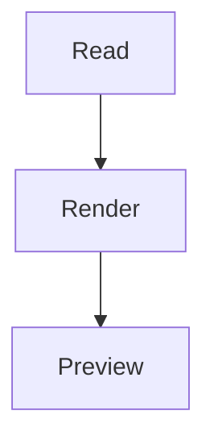
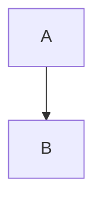

# DevTabs 阅读预览

## 清晰的 Markdown 层次

这是 **粗体**、*斜体*、~~删除线~~ 和 `行内代码`。[项目链接](https://example.com/docs)

> 引用应有可辨颜色，窄窗换行后继续对齐。中文、emoji 👩‍💻 和组合字符 é 保持完整。

- [x] 已完成的事项
- [ ] 仍待处理的事项，换行后与正文对齐，不重复项目符号。
  1. 有序嵌套列表
  2. 第二项

### 代码共用主题

```rust,no_run
fn main() {
    let answer = 42;
    println!("Hello DevTabs: {answer}");
}
```

```toml
[package]
name = "devtabs"
enabled = true
```

### 表格适应宽度

| 文件 | 作用 | 状态 |
| --- | --- | --- |
| Cargo.toml | 依赖和构建配置 | 已修改 |
| src/preview.rs | 文件预览与源码映射 | 已完成 |

### 图表与公式



质能关系：$E=mc^2$

$$
\frac{a+b}{c+d}
$$

$$
\begin{pmatrix}a & b \\ c & d\end{pmatrix}
$$

### 字面示例保留原文

````markdown
# 这是示例中的标题

````
